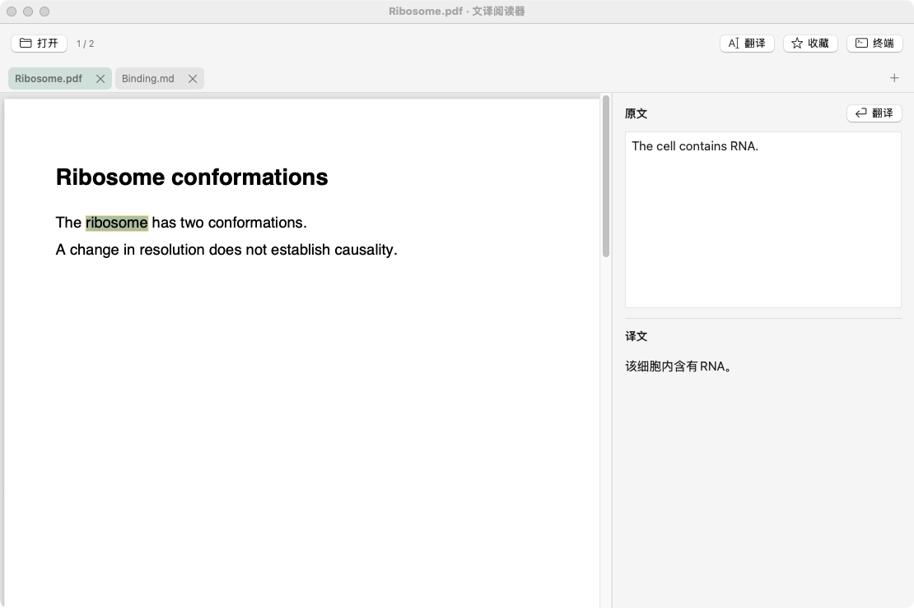

# hy-scholar · 文译阅读器

在 Mac 上读英文论文时，选中一个术语或一句话，就能在原文旁看到简体中文译文。文译阅读器使用腾讯 Hy-MT2-7B 在本机推理，支持 PDF 和 Markdown。

Read a paper on your Mac and select a term or sentence to see a Simplified Chinese translation beside the passage. Hy-Scholar reads PDFs and Markdown and runs Tencent’s Hy-MT2-7B locally on Apple Silicon.



## 阅读与翻译 · Reading and translation

| 中文 | English |
| --- | --- |
| 一次打开多篇文献，在标签间切换。重新启动时恢复标签及 PDF 阅读位置。 | Open several papers in tabs. Reopening the app restores the session and PDF reading positions. |
| 双击单词或拖选句子，在可拖动的浮窗里看流式译文。术语翻译参考所在原句。 | Double-click a word or select a passage for a streaming translation. Drag the pop-up by its title bar. Short terms use the surrounding sentence for context. |
| 点「翻译」打开独立侧栏，编辑或粘贴原文。切换文献时保留草稿。 | Open **翻译** to edit or paste your own text in the sidebar. Its draft stays in place while you read other tabs. |
| 在 PDF 或 Markdown 选区上右键，可高亮、加下划线、加删除线或收藏词汇。词汇栏显示释义和例句，模型补写的例句有单独标识。 | Right-click a selection to highlight, underline, strike through or save vocabulary. Each saved entry pairs its translation with an example. Generated examples are labeled. |
| 点「终端」打开本机交互式 shell。切换侧栏时保留会话。 | Open **终端** for a local interactive shell. Switching sidebar panels keeps the session alive. |

PDF 划词需要可选择的文本层。首次翻译会加载模型。阅读器将文献副本、标记、收藏和草稿保存在 `~/Library/Application Support/文译阅读器/`。

PDF selection requires a text layer. The model loads on the first translation. Imported documents, annotations, saved words and drafts are stored under `~/Library/Application Support/文译阅读器/`.

## 安装 · Installation

适用于 **Apple Silicon、macOS 15 或更高版本**。请安装 Apple Command Line Tools，以提供系统 Python 3 和构建工具。可在终端运行 `xcode-select --install`。

Requires **Apple Silicon and macOS 15 or later**. Install Apple Command Line Tools for the system Python 3 and build tools. Run `xcode-select --install` in Terminal if needed.

1. 从 [Releases](https://github.com/Jayliu0023/hy-scholar/releases/latest) 下载 macOS arm64 ZIP 并解压，将 `文译阅读器.app` 拖入「应用程序」。发布包采用本地 ad-hoc 签名，未经 Apple 公证；也可按下文从源码构建。

   Download the macOS arm64 ZIP from [Releases](https://github.com/Jayliu0023/hy-scholar/releases/latest), extract it and move `文译阅读器.app` to Applications. The prebuilt app is ad-hoc signed and has not been notarized by Apple. A source build is available below.

2. 下载下表中的两个文件。首次配置需要约 4.62 GB 模型权重，之后翻译可离线使用。

   Download both files below. The one-time setup needs approximately 4.62 GB of model weights. Translation then works offline.

   | 文件 / File | 下载 / Download |
   | --- | --- |
   | `Hy-MT2-7B-Q4_K_M.gguf` | [Tencent · Hugging Face](https://huggingface.co/tencent/Hy-MT2-7B-GGUF/resolve/ab8472660ac61fac25f1af43fac2599d52a8a775/Hy-MT2-7B-Q4_K_M.gguf?download=true) · [Tencent · ModelScope](https://modelscope.cn/models/Tencent-Hunyuan/Hy-MT2-7B-GGUF/resolve/master/Hy-MT2-7B-Q4_K_M.gguf) |
   | `llama-b11457-bin-macos-arm64.tar.gz` | [llama.cpp · GitHub](https://github.com/ggml-org/llama.cpp/releases/download/b11457/llama-b11457-bin-macos-arm64.tar.gz) |

3. 在解压目录或仓库根目录执行以下命令。安装器校验 SHA-256，将模型、`llama-server` 和启动脚本安装到 `~/.local/share/hy-mt2-7b/`。若下载到其他位置，请替换参数路径。

   From the extracted release directory or the repository root, run the command below. It verifies SHA-256 checksums and installs the model, `llama-server` and its launcher under `~/.local/share/hy-mt2-7b/`. Adjust the paths if your downloads are elsewhere.

   ```sh
   /usr/bin/python3 install-runtime.py \
     "$HOME/Downloads/Hy-MT2-7B-Q4_K_M.gguf" \
     "$HOME/Downloads/llama-b11457-bin-macos-arm64.tar.gz"
   ```

4. 打开应用，按 `⌘O` 选择带文本层的 PDF，双击一个英文单词即可验证翻译。运行时通过本机 Unix 套接字通信。

   Launch the app, press `⌘O` to open a PDF with selectable text, and double-click an English word to test translation. The reader and inference server communicate over a local Unix socket.

## 源码构建 · Build from source

```sh
git clone https://github.com/Jayliu0023/hy-scholar.git
cd hy-scholar
./build.sh "$PWD/build/文译阅读器.app"
open "$PWD/build/文译阅读器.app"
```

构建使用 Swift、AppKit、PDFKit 和 WebKit。使用翻译功能前，请完成上面的运行时安装。/ The native app uses Swift, AppKit, PDFKit and WebKit. Complete the runtime setup above to enable translation.

## 快捷键 · Shortcuts

| 操作 / Action | 快捷键 / Shortcut |
| --- | --- |
| 打开文献，可多选 / Open one or more documents | `⌘O` |
| 在新标签页打开 / Open in a new tab | `⌘T` |
| 下一个 / 上一个标签页 · Next / previous tab | `Ctrl+Tab` / `Ctrl+Shift+Tab` |
| 关闭当前标签 / Close the current tab | `⌘W` |
| 翻译侧栏输入的文字 / Translate the sidebar draft | `⌘Return` |

## 依赖与许可 · Dependencies and notices

翻译模型与推理引擎由各自项目发布。内置网页组件的许可文件随源码和应用分发。/ The model and inference engine are distributed by their respective projects. Notices for the bundled web components are included in the source and application.

[Hy-MT2-7B GGUF](https://huggingface.co/tencent/Hy-MT2-7B-GGUF) · [llama.cpp](https://github.com/ggml-org/llama.cpp) · [xterm.js notice](Resources/web/LICENSE-xterm) · [Marked notice](Resources/web/LICENSE-marked) · [DOMPurify notice](Resources/web/LICENSE-DOMPurify)
